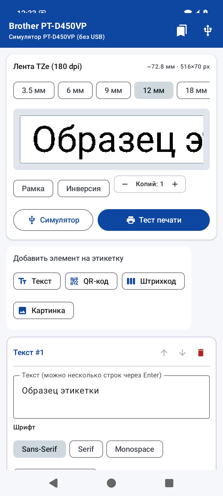
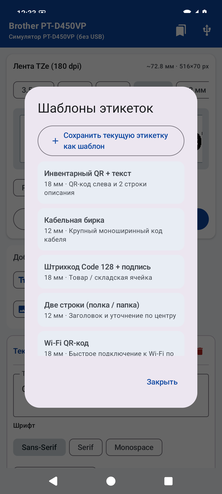
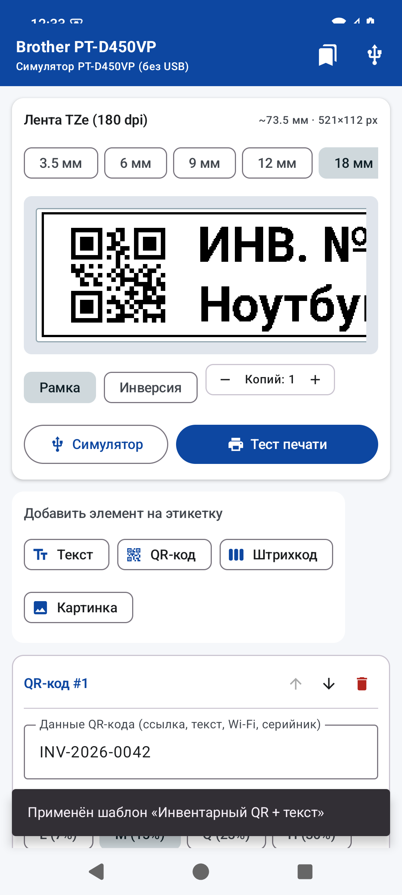
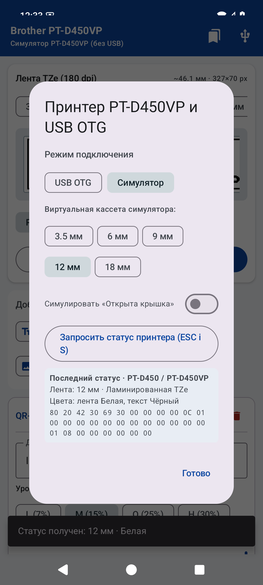

# Brother PT-D450VP — Android-приложение для печати этикеток по USB OTG

Нативное Android-приложение (Kotlin + Jetpack Compose + Material 3) для прямой печати этикеток на принтере **Brother PT-D450 / PT-D450VP** через кабель **USB OTG** по бинарному растровому протоколу Brother P-touch Raster (без проприетарного SDK).

**Текущая версия:** [`v0.1.2`](https://github.com/kprklg/android-brother-pt-d450vp/releases/tag/v0.1.2) · [CHANGELOG](CHANGELOG.md) · [План задач](TASKS.md) · [Правила работы](AGENTS.md)

## Возможности

- **Прямое подключение по USB OTG (`android.hardware.usb`)**:
  - Подтверждённый на реальном устройстве идентификатор: `VID 0x04F9`, `PID 0x2073` (`Brother Industries, Ltd PT-D450`).
  - Интерфейс `USB_CLASS_PRINTER (7)`, `EP 2 OUT (0x02)` и `EP 1 IN (0x81)`, Bulk 64 байта.
  - Чтение 32-байтного пакета статуса (`ESC i S`): автоопределение ширины и типа кассеты TZe, цвета ленты/текста, кодов ошибок (нет ленты, открыта крышка и др.).
- **Редактор этикеток с живым 1-битным WYSIWYG-предпросмотром**:
  - Поддерживаемые ширины лент TZe: **3.5 / 6 / 9 / 12 / 18 мм** (180 dpi, 128-пиновая термоголовка).
  - **Текст (однострочный и многострочный):** `Sans-Serif`, `Serif`, `Monospace`, `Condensed`, жирный/курсив, выравнивание, ручной размер или автоподбор под высоту ленты.
  - **QR-коды (ZXing):** поддержка UTF-8 (кириллица), коррекция ошибок `L / M / Q / H`, масштаб.
  - **Штрихкоды:** `Code 128`, `EAN-13`, `Code 39`, `Data Matrix`, толщина штриха, подпись под кодом.
  - **Картинки из галереи:** масштабирование, пороговая бинаризация или дизеринг Флойда–Стейнберга, инверсия.
  - Комбинирование нескольких блоков на одной этикетке, изменение порядка, рамка, инверсия, печать нескольких копий.
- **Шаблоны:** 6 встроенных шаблонов + сохранение, загрузка и удаление пользовательских шаблонов в JSON.
- **Симулятор и диагностика:** встроенный симулятор принтера (работает без USB), просмотр USB-устройств и hex-дампа пакетов, калибровка полей, Chain Print, PackBits TIFF и вертикального зеркалирования.

## Скриншоты интерфейса

| Экран | Скриншот |
|---|---|
| Редактор текста и живой 1-битный предпросмотр |  |
| Библиотека шаблонов (6 встроенных + сохранение своих) |  |
| Шаблон «Инвентарный QR + текст» на ленте 18 мм |  |
| Диалог «Принтер PT-D450VP и USB OTG»: статус, калибровка, hex-дамп |  |

> Скриншоты сняты с эмулятора Android 15 (Pixel 6) через `adb exec-out screencap -p`.

## Структура репозитория

```text
.
├── app/                     # Исходный код Android-приложения и юнит-тесты
├── docs/                    # Пошаговая документация проекта
│   ├── 01-environment-setup.md
│   ├── 02-protocol-and-hardware.md
│   ├── 03-architecture-and-features.md
│   ├── 04-git-crypt-and-releases.md
│   └── 05-testing-and-calibration.md
├── group_vars/all/
│   └── secrets.yml          # Зашифрованные секреты (git-crypt)
├── scripts/                 # Идемпотентные скрипты сборки, диагностики и экспорта сессий
├── session/                 # Зашифрованные выгрузки сессий OpenCode (*.json, git-crypt)
├── CHANGELOG.md             # История релизов
├── TASKS.md                 # Дорожная карта и список задач на будущее
└── .gitattributes           # Правила шифрования git-crypt
```

## Быстрый старт

### Сборка и юнит-тесты (идемпотентно)
```bash
./scripts/build-and-test.sh
```
Готовый APK появится по пути `app/build/outputs/apk/debug/app-debug.apk`.

### Установка на Android-устройство
```bash
adb install -r app/build/outputs/apk/debug/app-debug.apk
```

### Проверка принтера PT-D450VP на Linux (без расхода ленты)
```bash
python3 scripts/probe-printer.py
```

### Расшифровка секретов и сессий после `git clone`
```bash
git-crypt unlock /путь/к/android-brother-pt-d450vp.git-crypt.key
```
Подробности см. в [docs/04-git-crypt-and-releases.md](docs/04-git-crypt-and-releases.md).

## Документация по шагам

1. [Настройка среды разработки Android на Ubuntu](docs/01-environment-setup.md)
2. [Протокол Brother PT-D450VP и результаты снятия параметров с реального принтера](docs/02-protocol-and-hardware.md)
3. [Архитектура приложения и возможности редактора](docs/03-architecture-and-features.md)
4. [Работа с Git, git-crypt, выгрузкой сессий и релизами](docs/04-git-crypt-and-releases.md)
5. [План тестирования и калибровки печати на реальном железе](docs/05-testing-and-calibration.md)
